# VERDIGRIS
### *A Survey of the Copper Country*

An original open-world exploration game: a vast high-desert world, loot with surprise finds,
and a mystery that only closes if you actually reason your way through the evidence.

Built with the **REA Reverse Engineering** plugin's evidence discipline: every conclusion is
traceable to a source, observation is kept separate from inference, and unknowns stay unknown
until the player earns them.

---

## The setting

Forty-one years ago the town of **Verdigris Flats** emptied in a single night and was never
seen again. Eleven thousand people went somewhere. The paper record says they were evacuated.
The paper record is wrong.

You are a field investigator for the **Survey Office**. Your job is not to fight — it is to
search, read, and connect. Eight cold-case files are open. Close them and the town explains
itself.

## Screenshots

| | |
|---|---|
| 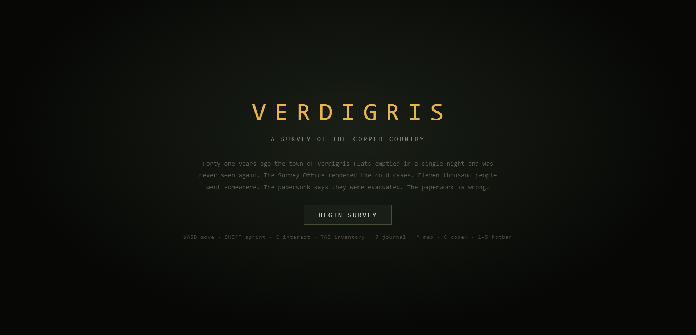 | 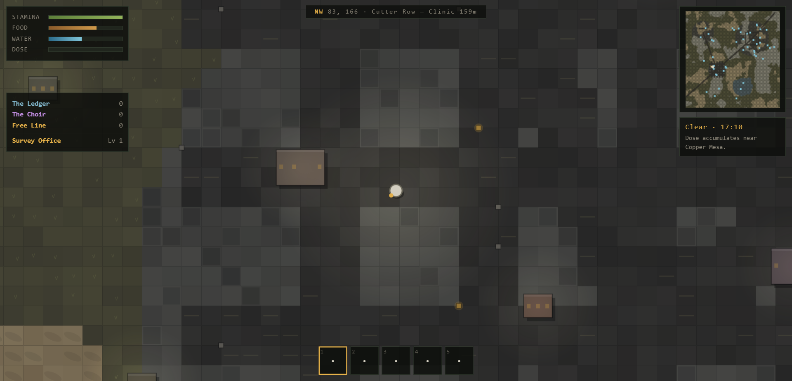 |
| The survey begins. | Charted ground, structures, and the town on the map. |
| 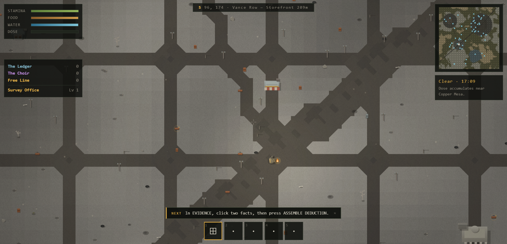 | 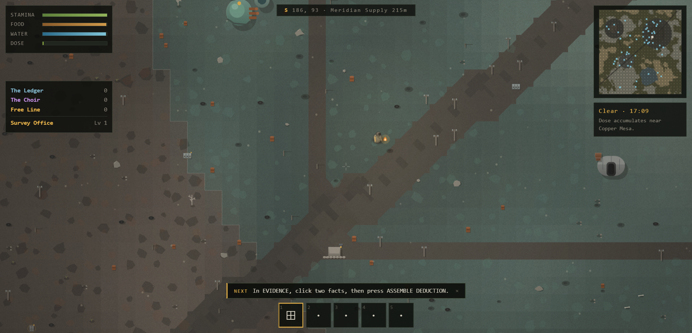 |
| Verdigris Flats — a street grid, concrete, telegraph poles, the market awning. | Copper Mesa Station: the oxidised pad, the containment dome, the substation. |
| 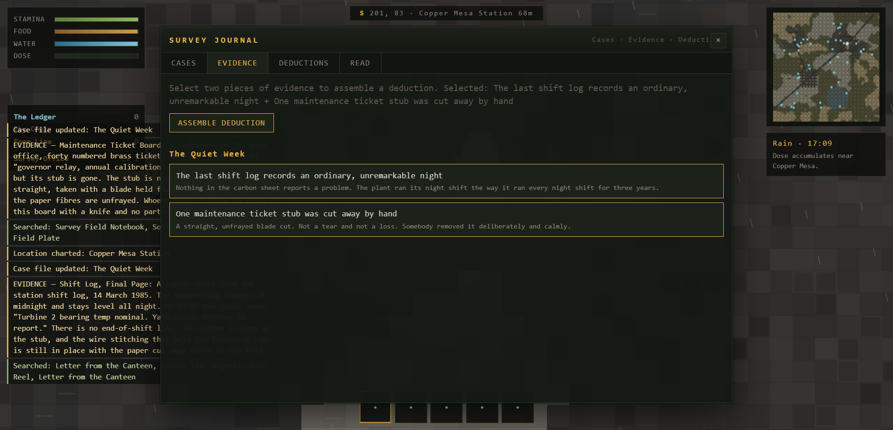 | 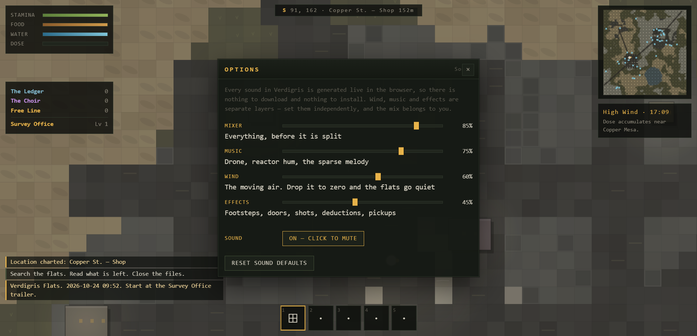 |
| The Evidence tab — two facts selected, ready to assemble a deduction. | The mixer: music, wind and effects, set independently. |
| 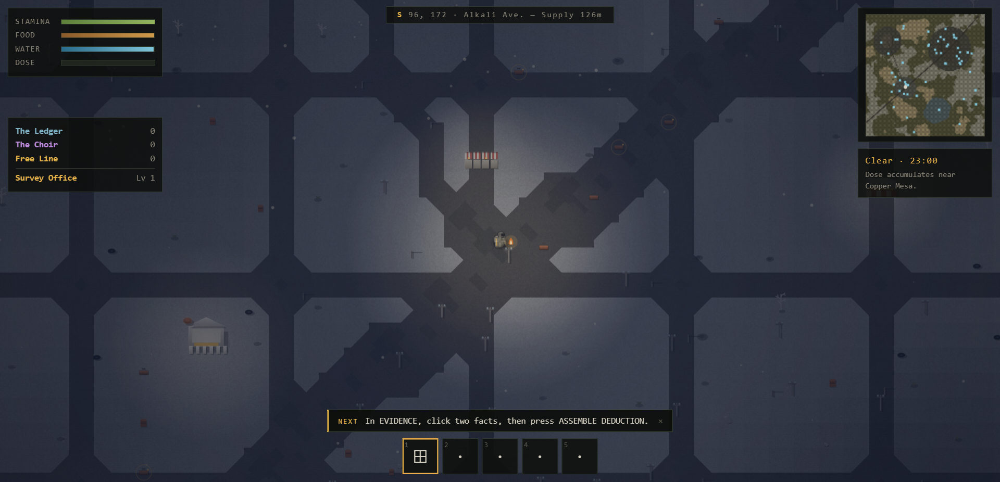 | 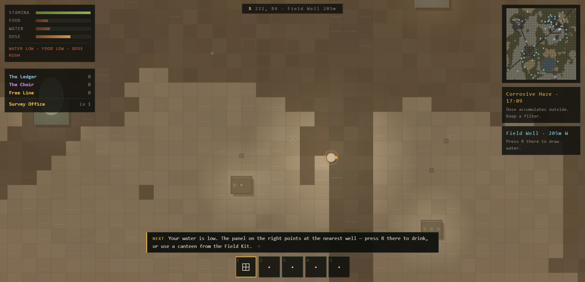 |
| After dark: your torch, lit windows, a red lamp on the relay mast. | The HUD names what is running low, and the coach says what to do about it. |
| 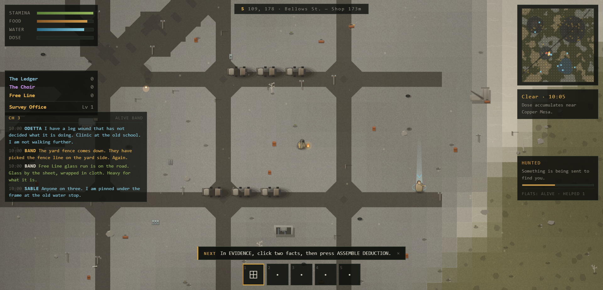 | 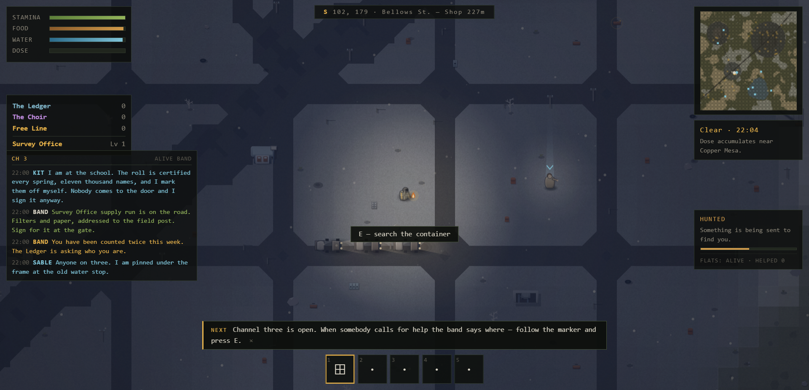 |
| Channel three on the left, a distress call answered on the right, a convoy on the road. | The same channel after dark: a survivor with a beacon, headlights on the highway. |
| 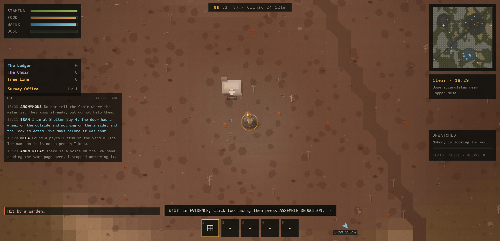 | 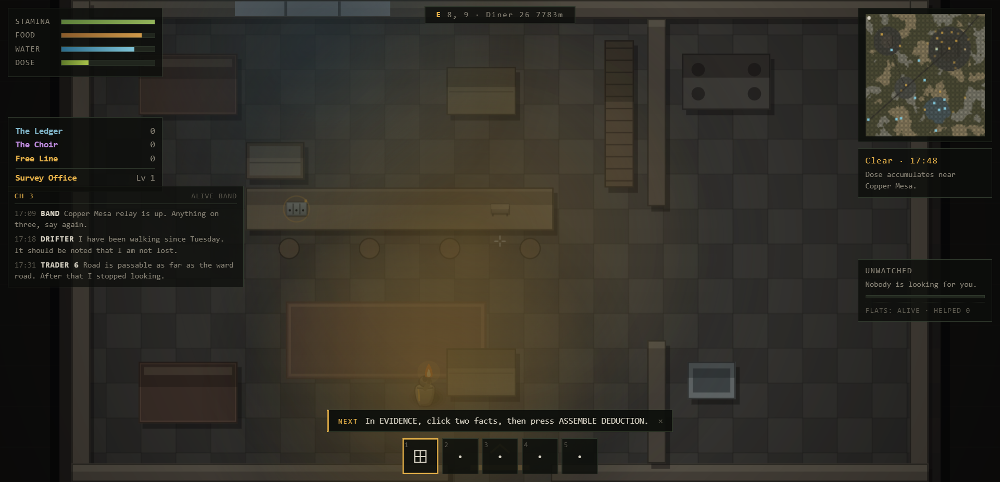 |
| A marked threshold on the south face of a building. Press `E` and go in. | The Diner: a counter, four stools, a stove, and the crates that used to sit in the yard. |
| 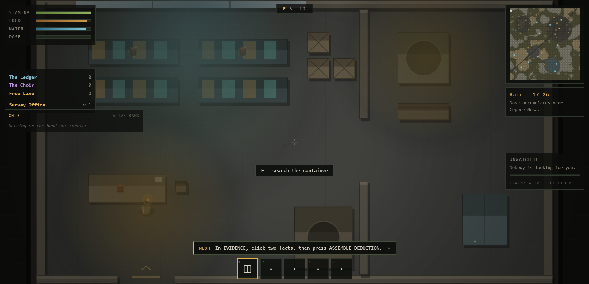 | 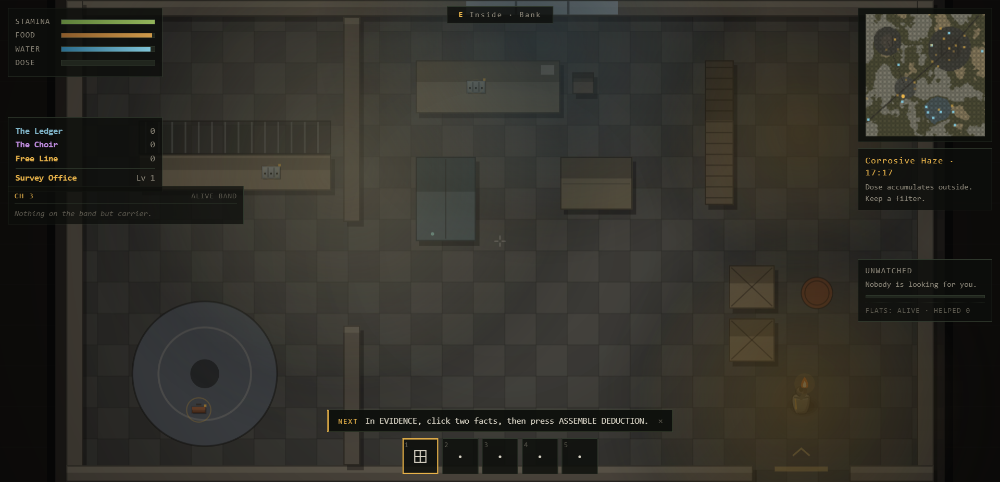 |
| Copper Mesa control building — console banks, the reactor pit, the crates on the panels. | The bank: a teller counter with brass grilles, a vault door, and a filing cabinet. |
| 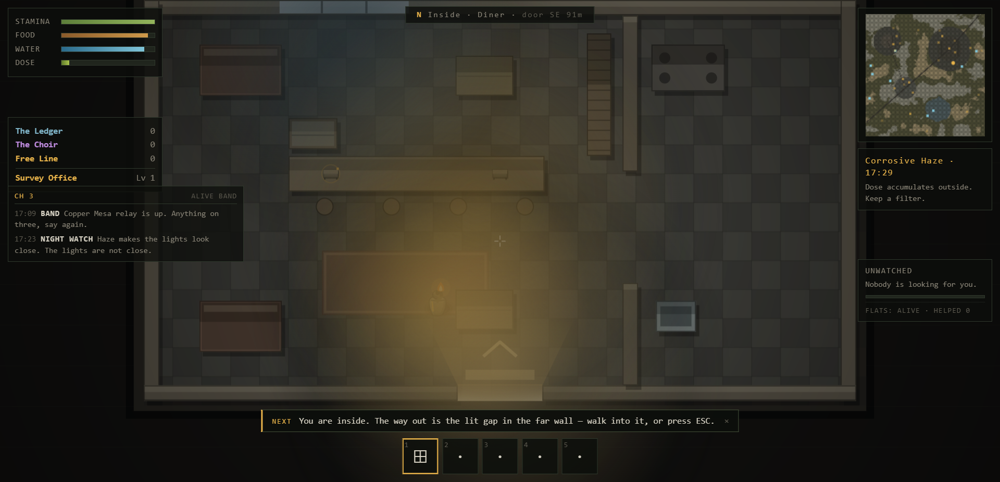 | 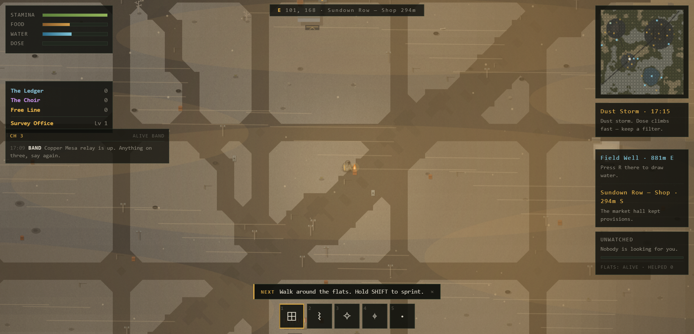 |
| The way out of any room: daylight through the gap, a lit threshold, a chevron pointing out. You can walk straight through it, or press `ESC`. | The panel on the right: the nearest well when you are thirsty, the nearest building that kept provisions when you are hungry. |
| 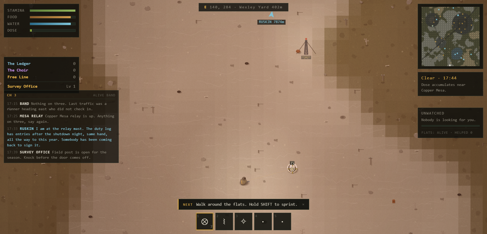 | |
| The mouse is the aim. The reticle sits under the cursor, the round goes exactly there, and the thing you hit flares white with the damage over it. Slot 1 shows the rounds left. | |

## What is in here

| System | What it does |
|---|---|
| **World** | 288 × 288 tiles of procedurally generated high desert: salt flats, dunes, scrub, a company town, an industrial belt, a reactor yard, a dry lake. Roads, street grids, ~74 structures, ~180 searchable containers. Every seed spawns you beside a field camp with company within a few tiles. |
| **Discovery** | You chart places by walking to them. The map fills in as you go; a POI appears once you are within 260 px. |
| **Loot** | 75 items across 8 categories and 5 rarities. Containers roll by tier — a bank holds better things than a campfire. **Surprise finds** are flagged separately in the log. |
| **Mystery** | The core. 8 cases, 47 physical clues, 8–12 established facts per case, and a chain of deductions. Read a clue → it establishes a fact. Combine two facts → a deduction yields a new fact. Reach the right facts → you can file a conclusion and close the case. |
| **Factions** | The Ledger (keeps the record true), The Choir (worship the machine), Free Line (want the grid running). Reputation gates contracts and shapes who will deal with you. |
| **Contracts** | 11 faction contracts, tiered by standing. Turning one in shifts reputation and pays in goods. |
| **Buildings** | The buildings have insides. Seventeen **hand-built rooms** — one for every kind of building that holds a clue — and every building of those kinds on the flats can be entered: a diner, a substation, a bank, a bunker, the control building at Copper Mesa, a sheriff post, a clinic, a school, the market hall. Walk up to a marked threshold and press `E`. Inside there is a floor, walls you cannot walk through, furniture, a torch that still works, and **the crates that used to sit in the yard**. The clue you are chasing is in the room that describes it. |
| **The living flats** | The flats are not scenery. **Channel three** carries traffic from the people still out there, and it runs in the HUD like a radio you leave on. A **distress call** puts a marker on your map and a beacon on the ground — walk to it and press `E`, and you get supplies, sometimes testimony, and sometimes nothing at all, because some calls are lures. At night the **Rusted raid** places worth taking, convoys run the road with their headlights on, and everything you take raises your standing with whoever is keeping the ledger until something comes looking for you. A **pressure meter** on the right tracks that: Unwatched → Noticed → Hunted → Marked. |
| **Look** | The world is drawn from the data the generator already computes: **elevation** drives a north-west hillshade, so the flats read as landform rather than a colour map; every biome has its own palette and surface detail; all **30 structure types have their own silhouette** (a gabled house, a lattice relay mast, a blast door, a row of market stalls); the ground carries **clutter** — rocks, dead trees, barrels, tyre stacks, telegraph poles along the highway; and roads are drawn with diagonal connectors so a highway reads as a road rather than a staircase of squares. Air is full of dust, the frame has a vignette and film grain, and the light is graded for the hour. |
| **Survival** | Stamina, food, water, and **dose**. The reactor yard is hot; a corrosive haze storm makes the open flats lethal. Filters help. Every need is a clock: the HUD pulses the bar and names the problem before a need runs out, the coach tells you how to fix it, and panels on the right point you at the nearest well when you are thirsty and the nearest building that kept provisions when you are hungry. |
| **Combat** | 14 weapons and 8 pieces of armour. Every weapon has a **reach**, a **rate of fire**, a **damage** figure and a **mod tag**, and every tag does something: `heavy` hits harder, `rapid` fires faster, `accurate` adds a fifth more punch, `silenced` means the Rusted notice you half as far off, `nightvision` lets you see 150 px further into the dark, `tough` adds a third to a plate. The **Flare Pistol** barely damages anything — it throws a signal flare that lights the ground around you for fifteen seconds. **The mouse is the aim**: the reticle is drawn under the cursor, a held left button fires at the weapon's rate, the round goes exactly where the reticle is, your figure turns to face it, and a hit leaves a mark and a damage number. |
| **Day/night + weather** | Clear, wind, rain, corrosive haze, and a **dust storm** that sweeps across the flats as a visible front. The sky turns over at twenty-four times real time, so one survey runs from afternoon into dusk and then into the dark — which is when the rusted come out and when the torch, the lit windows and the convoy headlights actually matter. |
| **Crafting** | 11 recipes across field craft and workbench. |
| **Save** | `F` saves to localStorage. The title screen resumes your last survey. |
| **Sound** | Music and effects are **synthesised live in the browser** with the Web Audio API. There are no audio files anywhere in this project. Four independent layers — mixer, music, wind, effects — each on its own slider under `O`. The ambience reacts to the hour and the weather, and a reactor hum fades in as you approach Copper Mesa Station. `N` mutes. |
| **Onboarding** | `H` opens the Field Manual: every control, a Survival table that says what drains each need and how to put it back, plus a checklist that ticks off as you learn the mechanics. A single line at the bottom of the screen tells you the next thing to try. |
| **Options** | `O` opens the mixer *and* the flats dial — **Quiet**, **Alive** or **Dangerous**. Quiet keeps the radio and the weather but nobody needs you and nothing hunts you. Alive is the default. Dangerous is busier, richer, and it is keeping count. The story is identical in all three. |

## Running it

**Double-click `play.bat`**, or open `index.html` directly. No build step, no install, no
server — plain scripts, so `file://` works.

**Or just use the shortcut.** There is a `VERDIGRIS` shortcut on the desktop and one in the
Start Menu (`Start Menu ▸ Programs ▸ VERDIGRIS`). Both point at `play.bat`, carry the game's
own icon, and need no knowledge of where the folder lives. If you move the game folder, the
shortcut still works — it resolves through the batch file next to it.

For couch play on a laptop or tablet, run **`serve.bat`**. It serves the folder on port 8123
bound to your network and prints the address to open. Requires Node or Python on PATH. The server
it launches sends `no-store`, so a reload always picks up the file you just edited — a cached
script that silently runs the old code is the worst kind of bug to chase.

If your browser blocks local files, serve the folder yourself:

```
python -m http.server 8123
```

then open <http://127.0.0.1:8123/>.

## Learning to play

A new player should never have to guess.

- **`H` opens the Field Manual** at any time: every control in one place, a Survival table that
  says what drains each need and how to put it back, plus a checklist that ticks off as you
  actually use each mechanic.
- **A coach line sits above the hotbar** and names the next thing to try — walk, search, read
  a clue, assemble a deduction, file a conclusion. It steps forward as you go and disappears
  once you have it all. `×` dismisses it; the manual has a **RESET TUTORIAL** button.
- **When a need gets low the coach says so first**, and the HUD pulses the bar and names the
  problem (`water low · food low · dose high`) before it becomes an emergency.
- **The title screen names `H`, `O` and `N`** so nobody has to find them by accident.

## Buildings you can go inside

Every building in the survey used to be a silhouette: you could walk up to the Diner, survey it,
and read a sentence about it. There was no inside — no door, no wall, no collision anywhere in the
game. That is now the other way round.

- **Seventeen hand-built rooms**, one for every kind of building that holds a clue: the **Diner**,
  the **Substation**, the Copper Mesa **control building**, the **Sheriff Post**, the **Clinic**,
  the **Pump House**, the **Market**, the **Library**, the **Storefront**, the **School**, the
  **Freight Depot**, the **Guard Post**, the **Bank**, the **Bunker**, the **Relay Hut**, the
  **Fuel Stop**, the **Observatory**. Every building of those kinds on the flats has one, so there
  are thirty-odd enterable buildings on any seed.
- **Doors are marked.** A small amber threshold and a chevron sit on the south face of every
  building you can enter. Stand on it and the prompt reads `E — go inside`.
- **The way out is never a puzzle.** Inside, the doorway is the brightest thing in the room: daylight
  through the gap, a lit threshold on the floor, a chevron pointing out, and a glow you can see from
  the far corner. The room is fitted into the band of screen above the hotbar, so the doorway is never
  hidden behind a slot box. You can **walk straight out** through the gap — there is nothing to
  press — and `ESC` steps back outside if you would rather not walk. The compass reads
  `Inside · Diner · door SE 91m`, so the way out always has a direction and a distance.
- **A room is a room.** Walls, partitions and furniture are solid. You slide along them. You cannot
  walk through a counter or out through a wall — and a partition cannot seal you in, which is
  checked by flooding the floor of every room from the point you land on.
- **The crates moved in.** The loot that used to sit scattered in the yard now sits where it
  belongs: on the diner counter, on the substation panels, behind the bank counter. So does the
  file you are chasing. A clue that belongs in a sheriff post is in the sheriff post.
- **Indoors is its own scene.** The flats are suspended while you are inside — the radio keeps
  talking on the band but nothing walks up to the door. The compass names the room instead of
  giving you coordinates that mean nothing on the map, and the minimap puts you on the building
  you are in.
- **The light follows the hour.** Windows let the daylight in; lamps, the reactor glow, and your
  torch light the room when the sun goes down. Outside it is 24× faster, so a room you walk into at
  dusk is a different room at midnight.

## The channel

The flats talk on channel three, and the game listens.

- **The radio** sits under the faction standings on the left. Ambient traffic, faction business and
  warnings all come through it. It is never more than a glance — it is a background you can read.
- **A distress call** puts a cyan marker on your map and a beacon on the ground. Walk to it and press
  `E`. Most calls are honest: you get supplies, some scrap, and sometimes a survivor's testimony
  that establishes a fact in a case you have already opened. Some calls are **lures** — the voice
  repeats itself and sounds wrong, and answering it puts the Rusted on top of you.
- **Raids** happen after dark. The band tells you where before they land; if you get there first
  there is a fight and a prize, and if you do not, the place is simply worse than it was.
- **Convoys** run the road whether or not you are watching. They have headlights, they carry
  freight, and they are on the map while they are moving.
- **Pressure** builds from what you take and what you kill, and it does not go down on its own. The
  meter on the right goes Unwatched → Noticed → Hunted → Marked, and at the top of that range
  something is sent to find you.
- **The dial.** `O` → The Flats → **Quiet / Alive / Dangerous**. Quiet leaves the radio and the
  weather and takes the rest away. The eight case files do not change either way.

## Weapons

You start with a scavenger's torch and six rivet coins. Everything else you find.

| Weapon | Reach (m) | Between shots | Tags | Notes |
|---|---|---|---|---|
| **Scavenger's Torch** | 40 | 0.73s | — | The starting weapon. Swings, costs nothing, always there. |
| **Pick Mace** | 45 | 0.96s | heavy | Melee, and a good one. |
| **Rivet Sling** | 95 | 0.62s | rapid | Copper coins, and there are six in your pack already. |
| **Sawn Dust Pump** | 90 | 0.74s | rapid | Cut short and re-choked. Loud, and it does not care. |
| **Dust Pump** | 90 | 0.87s | — | A shotgun. Brutal at arm's length, useless past the next wall. |
| **Flare Pistol** | 120 | 0.87s | — | Does almost no damage. Lights the ground for fifteen seconds. It is not a joke. |
| **Longhorn Revolver** | 150 | 0.73s | accurate | The most honest gun in the catalog. |
| **Ledger Issue Sidearm** | 160 | 0.59s | accurate | Station-issued. The Ledger would like it back. |
| **Tracer Carbine** | 200 | 0.26s | rapid, silenced | Fast and weak — but you can walk right up to a Rusted with one of these. |
| **Survey Carbine** | 220 | 0.45s | accurate | The Survey Office standard. Does everything adequately. |
| **Sodium Lance** | 260 | 0.62s | rapid, nightvision | You see 150 px further into the dark than anything else on the flats. |
| **Mesa Bolt Rifle** | 300 | 0.96s | heavy, accurate | One shot, and it is a good one. |
| **Copper Mesa Repeater** | 320 | 0.50s | accurate, rapid, silenced | The best gun in the game, and it is worth less than the Sodium Lance. |
| **Long Marksman** | 340 | 0.96s | heavy, accurate | The furthest thing you can carry. |

**What is not in here yet:** no magazines or reload timing, no way to modify a weapon at the
workbench, no aiming down sights, and no dodging. The combat loop is deliberately plain — you
pick the right tool for the distance, you manage the ammunition, and you keep your distance from
the Wardens. That is a fine small system, but it is a small one.

## Aiming and shooting

The mouse is the aim. That is the whole rule, and the game says so in as many words: **the
reticle sits under your cursor, and the round goes exactly where the reticle is.** No spread, no
invisible cone, no aim assist that quietly helps you.

| Rule | What it means in play |
|---|---|
| **Aiming** | Move the mouse. The amber reticle is drawn under the cursor, not in the middle of the screen — this is a top-down world, and a reticle in the middle of the screen would point at nothing. A faint line runs from your figure to the reticle so you can see the line of the shot. |
| **Your body follows the aim** | The surveyor turns to face where you are pointing, so a round leaves the body in the direction you are pointing. Walking and aiming at once is not a contradiction. |
| **Firing** | **Hold the left mouse button.** It fires at the weapon's rate of fire, so a single click is one shot and a held button is a stream. The click is not a toggle. |
| **Reach** | A weapon's reach is the distance its round lives. The revolver's round dies at 150 metres, the marksman's at 340. Reach the target in range and it is hit; reach past it and the round goes into the dust. |
| **Swinging** | A weapon with a short reach is **swung, not fired** — the torch and the pick mace. It draws an arc where it lands, in front of you, and it needs no ammunition. |
| **Ammunition** | The hotbar slot shows the rounds left in the weapon: `⊗ 8`. You find out you are empty by looking, not by clicking at the worst possible moment. |
| **Hit feedback** | A round that connects leaves a mark where it landed and the damage number over it, and the thing you hit flares white. A shot and a miss do not look the same, so you can learn what your weapon does. |

Everything above is in the **Field Manual** under `H` → *Shooting*, and the coach says it once
when you first pull the trigger: *"The mouse aims and the left button fires. The round goes
exactly where the reticle is — no spread — and your figure turns to face it."*

## Sound

Every sound is generated live in the browser — there is not a single audio file in the project.
`O` opens the mixer, with four layers you can set independently:

| Layer | What it carries |
|---|---|
| **Mixer** | Everything, before it is split. |
| **Music** | The drone, the reactor hum, the sparse pentatonic melody. |
| **Wind** | The moving air over the flats. Its own layer, so you can keep the music and drop the wind entirely. |
| **Effects** | Footsteps, doors, shots, deductions, pickups. |

`N` mutes everything. The mix reacts to the hour and the weather: the drone opens up at night,
the wind rises in a haze storm, and the reactor hum fades in as you approach Copper Mesa Station.

## Publishing it to a public URL

The game is a self-contained static site — `index.html` plus `src/`, no build, no dependencies.
Any static host will serve it as-is.

**It is live: <https://61zhlfwnyj0yx.space.minimax.io>** — the current build, with the shooting
work in it. Published from the `dist/` folder: 24 files, 540 KB, and it boots and plays from the
public URL with a clean console. Drive node `456222538010729` — publish against that node to
update this URL in place rather than minting a second one.

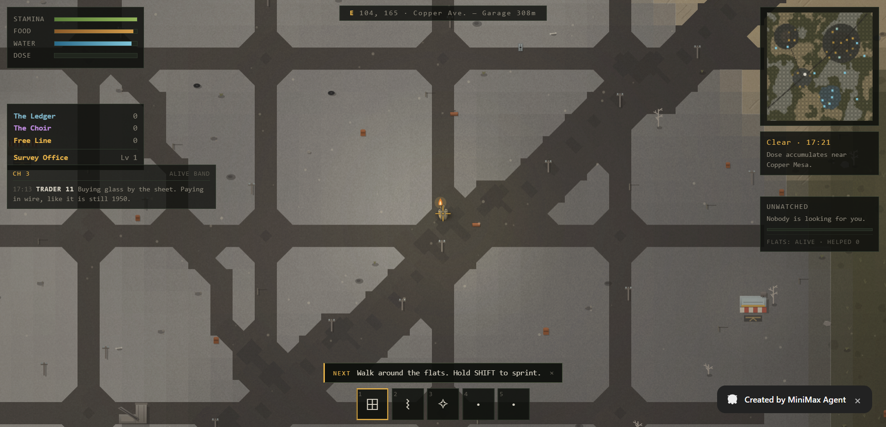

A note on the publisher, because it cost a day. The in-app publisher fails with
`HTTP 401 {"error":"invalid access token"}` when it asks the platform backend for an upload URL,
and the cause is **not** a bad login. The app's own token, read straight out of
`%USERPROFILE%\.minimax\auth\prod\en\mcode-public\auth.json`, is accepted by that exact endpoint
with `HTTP 200` — the app is simply holding a credential it captured before the token was
rotated. The fix is to let the refresh settle and try again; a restart of the app makes it
immediate. Signing out and back in is not required and changes nothing on its own.

The site itself is verified to run from `file://` as well, with a clean console.

## Controls

| Key | Action |
|---|---|
| `W A S D` / arrows | move |
| `Shift` | sprint (drains stamina) |
| mouse | aim — the reticle sits under the cursor · **hold** left click to fire · the round goes exactly where the reticle is |
| `E` | search a container · survey a location · answer a distress call · go through a door |
| `ESC` | close a panel · step back outside if you are inside a building |
| `R` | draw water at a well or a water tower |
| `1`–`5` | hotbar · `Space` to use/equip |
| `Tab` | inventory |
| `J` | journal — cases, evidence, deductions, reading |
| `M` | map |
| `C` | codex — factions and contracts |
| `K` | workbench |
| `B` | contracts |
| `H` | field manual — every control, the survival table, plus the tutorial checklist |
| `O` | options — mixer, sound layers, and how alive the flats are |
| `N` | mute / unmute |
| `F` | save |
| `Esc` | close panel |

## Putting a need back

Nothing in the flats refills itself. Five needs, five answers, all listed in the Field Manual
under **Survival**:

| Need | What drains it | How to put it back |
|---|---|---|
| Stamina | Sprinting, 15 a second. Walking costs nothing. | Recovers at 5.5 a second on foot, 12 standing still. |
| Food | Time, faster while you move — about seven minutes of walking. | Ration Tin (+20) or Survey Office Pack (+35). Craft a Ration Tin from cloth and ceramic at the workbench. **Seven kinds of building kept provisions — the diner, the market hall, the bunker, the school, the depot, the fuel stop office, the clinic — and the panel on the right points you at the nearest one.** |
| Water | Time, faster while you move — the fastest drain of all, about five minutes of walking. | Canteen (+25) or Survey Office Pack (+20). Craft a Canteen from ceramic and plastic. **Press `R` at any well or water tower to drink (+35)** — well water costs 3 dose, tower water does not. |

### Finding water

You should never have to guess where the water is.

- **Wells and water towers are on the map and the minimap from the start**, drawn in cyan. They are
  public infrastructure; the Survey Office knows where they are even before you get there.
- **When your water drops below 55, a panel appears on the right** naming the nearest well or
  tower, its distance, and its bearing — "Water Tower 25 · 580m SE". Walk there and press `R`.
- The coach strip names the problem before it becomes an emergency, and the HUD pulses the water
  bar and prints `water low` under the stats.

Every seed carries at least five water sources, and the nearest one to your spawn is never more
than about nine hundred metres — a few seconds' walk.

### Finding food

Food does not have a pump you can stand at, so it has to live somewhere you can walk to instead.

- **Seven kinds of building kept provisions**: the **diner**, the **market hall**, the **bunker**,
  the **school**, the **freight depot**, the **fuel stop office**, and the **clinic**. Every one of
  them on the flats holds at least one ration — not a chance roll, a guarantee. A diner that
  *might* have a tin in it is not a destination; a diner with a tin in it is.
- **When your food drops below 55, a panel appears on the right** naming the nearest of them, its
  distance and its bearing — "Sundown Row — Shop · 294m S · The market hall kept provisions." It
  sits under the water panel, so when you are low on both you can see both at once.
- **You can make it.** One cloth scrap and one ceramic scrap make a Ration Tin at the workbench
  (`K`), which is where the cloth and the ceramic come from in the first place.
- **What you find lands somewhere you can reach.** A consumable goes into a free hotbar slot the
  moment you pick it up, and the log says which number to press. Eat it with `SPACE`. A tin you
  cannot eat is not food.
- Every seed carries at least three places that kept provisions, and the nearest one to your
  spawn is close.

| Health | Starvation, dehydration, dose, and the Drovers. | Field Dressing (+18), Saline Stim (+45), Splint Kit (+30), Surgical Tray (+70). Also heals slowly on its own while you are fed, watered, and under 40 dose. |
| Dose | The refinery, the reactor yard, ash haze, and rusty well water. | Chalk Draught (−20), Saline Stim (−6), Surgical Tray (−12). Carry a **Survey Dust Filter** and it builds a third as fast — it is never consumed, it just works while it is in your pack. |

## How a case actually works

1. The **Cases** tab lists eight files. Most start unopened.
2. Each clue hides in a container at a specific kind of location — a shift log in a
   substation, a photograph in a diner, a deposition in a sheriff post. Search containers to
   find them.
3. Reading a clue establishes a **fact** — a claim, not a topic. *"The plant was shut down by
   hand at 04:12."*
4. In the **Evidence** tab, select two known facts and press **ASSEMBLE DEDUCTION**. If the
   pair genuinely implies something, you get a new fact and a note explaining why.
5. When you hold the facts a case needs, the case page offers **FILE CONCLUSION**. Close it
   and you take the case reward, faction standing, and 250 XP.
6. Close all eight and the Survey Office has to write its final report.

The deduction chains are acyclic and every fact is reachable, so nothing is unwinnable and
nothing is given away for free.

## Layout

```
index.html        shell, HUD markup, all styling
play.bat         one-click launcher
serve.bat        LAN server launcher for couch play
serve.js         the LAN server itself — sends no-store so a reload always picks up your edits
src/core.js       seeded RNG, value noise, colour + math helpers, the clock
src/world.js      biome field, roads, POI placement, clue placement, spawns
src/interiors.js  the seventeen hand-built rooms, entering, leaving, indoor collision
src/items.js      75-item catalog
src/factions.js   3 factions, 11 contracts
src/cases.js      cold cases, chapters 1–2
src/cases_b.js    cold cases, chapters 3–4
src/loot.js       loot tables, surprise finds, crafting recipes, where provisions are kept
src/player.js     movement, needs, dose, inventory, using items, combat maths
src/dynamic.js    the living flats engine — radio, calls, raids, convoys, pressure
src/dyn_content.js the words on the band: 30 ambient lines, 18 calls, 8 raids, 5 convoys
src/render.js     canvas rendering — draw order and the frame
src/gfx_terrain.js  terrain: biome palettes, elevation hillshade, roads, cached tile colour
src/gfx_props.js    structures: 30 POI silhouettes, ground clutter, containers
src/gfx_actors.js   actors: the player, the Rusted / Drovers / Wardens, projectiles
src/gfx_atmos.js    atmosphere: lighting, day/night grade, dust, weather, vignette, grain
src/gfx_live.js     the living flats: survivors, beacons, convoy trucks, edge guidance
src/gfx_interior.js interiors: floors, walls, furniture, room light, and the door markers outside
src/ui.js         HUD, inventory, journal, map, codex, crafting, contracts, options
src/save.js       localStorage persistence
src/audio.js      Web Audio engine — four mix buses, ambience, sound effects
src/help.js       field manual, controls reference, survival table, coach
src/main.js       input, game loop, interaction, enemy AI, conclusions
docs/ART_DIRECTION.md  the visual contract the four gfx modules are built against
test/smoke.js     headless validation — content graph, 20 world seeds, item-id integrity
test/gfx.js       headless validation — graphics module contract, biome distinctness, hillshade
test/live.js      headless validation — the living layer end to end, ghost ids, no-crash paths
test/interiors.js headless validation — the rooms are enterable, connected, and collision holds
```

## Testing

```
node test/smoke.js
node test/gfx.js
node test/live.js
node test/interiors.js
```

`smoke.js` validates the item catalog, the deduction graph (acyclicity, reachability, every solution
derivable), clue placement into containers, that **20 different seeds** all place every clue and
every POI type, and that **every item id the game hands the player actually exists** — starting
kit, crafting recipes, contract requirements and case rewards all resolve to real catalog items.
That last check exists because a ghost item id is invisible in the inventory, does nothing when
used, and silently eats the materials that produced it.

It also validates the **food loop** end to end, because food is the one need that has to be
*scavenged* rather than drawn from a well, and a food table that names an item nobody ever
receives is the same bug as a reward that names an item which does not exist. So it asserts that
every building that keeps provisions actually holds them, opens one, asserts the pack grew with a
real catalog id, **eats it**, and asserts the food bar moved and the tin was consumed — then
asserts the same for a crafted tin, that a found ration lands in a hotbar slot you can press,
and that the slot does not keep offering what you just ate. Exits non-zero on any failure.

It also validates **how shooting works**, because the shot is the one thing in the game that the
player cannot infer from the shape of the data. So it asserts that a gun puts a round in the air,
that the round goes **exactly where the pointer is** — no spread — that the round hits what the
pointer was on, that the hit leaves a mark you can see, that the thing that was hit flares, that
a melee swing is drawn where it lands, that the gun shows how many rounds are left, that a swung
weapon shows no count at all, that a box of ammunition shows its own count, and that the Field
Manual actually explains aiming, reach and swinging. The reticle used to be drawn in the middle of
the screen while the round flew to the cursor, and no data-shape test on earth would have found
that. Exits non-zero on any failure.

`gfx.js` validates the graphics contract: every module exports the API the renderer calls, every
biome produces a visibly distinct ground colour, **elevation actually changes what is drawn**,
the terrain cache is reused per seed and rebuilt on a new one, every one of the 30 POI types has
its own silhouette, and the old flat-renderer code paths are gone. Those last two exist because a
data-shape test is structurally incapable of seeing a painter that simply ignores the data it is
given — which is exactly how the world ended up looking like a spreadsheet. Exits non-zero on any
failure.

`live.js` validates the living flats, and it validates the **engine path** rather than the data
shape — because a reward that names an item which does not exist consumes the reward and produces
nothing the player can see, and no amount of checking that the string is well-formed will catch
that. So it answers a call and asserts the inventory actually grew with catalog ids; answers a
lure and asserts the inventory did not grow and the hostiles did appear; runs a raid and asserts
raiders reached the map; and runs all three intensity profiles for a simulated stretch of time and
asserts Quiet produces no calls while Dangerous produces strictly more of everything than Alive.
It also asserts the live renderer draws something, survives a null dynamic state, and never throws
on an empty world or a missing player. Exits non-zero on any failure.

`interiors.js` validates the buildings, and it validates the **engine path** rather than the data
shape, for the same reason: a room can be perfectly well formed and still be a room you cannot
get into. So it walks the whole loop — walk to a door, go in, stand on a crate, open it, get real
catalog items, walk to the doorway, come back out — and asserts the inventory grew with ids that
exist. It floods the floor of every one of the seventeen rooms from the point the player lands on
and asserts the doorway is reachable, because a partition wall is exactly the kind of thing that
seals a player in a room they cannot leave. It asserts no crate is claimed by two buildings, that
every clue marker points at the building that holds it, that no piece of furniture is buried in a
wall, and that a single large movement step cannot tunnel through a counter.

It also asserts the things that make a room **leavable**, because a player who cannot find the way
out is stuck in a room no flood-fill will catch: that the doorway lands on screen and clear of the
hotbar in every room at six window sizes, that walking into the gap in the wall leaves the
building, that stepping out puts you clear of the threshold so the door cannot grab you back, and
that the compass points at the door and points at *north* when you walk north. That last check
exists because the compass was a quarter turn out of true — it said south while you walked east —
and a compass that lies is worse than no compass, because you stop trusting the one direction it
is trying to tell you. Exits non-zero on any failure.

## Originality

Every name, place, item, faction, and piece of lore in this game is original. No Fallout
assets, names, text, or terminology were copied. The mechanics are inspired by the survival-
exploration genre; the content is its own. Vocabulary is deliberately different: *dose* not
radiation, *scrap* not caps, *the Rusted* and *Drovers* for hostiles, and no VATS analogue.
